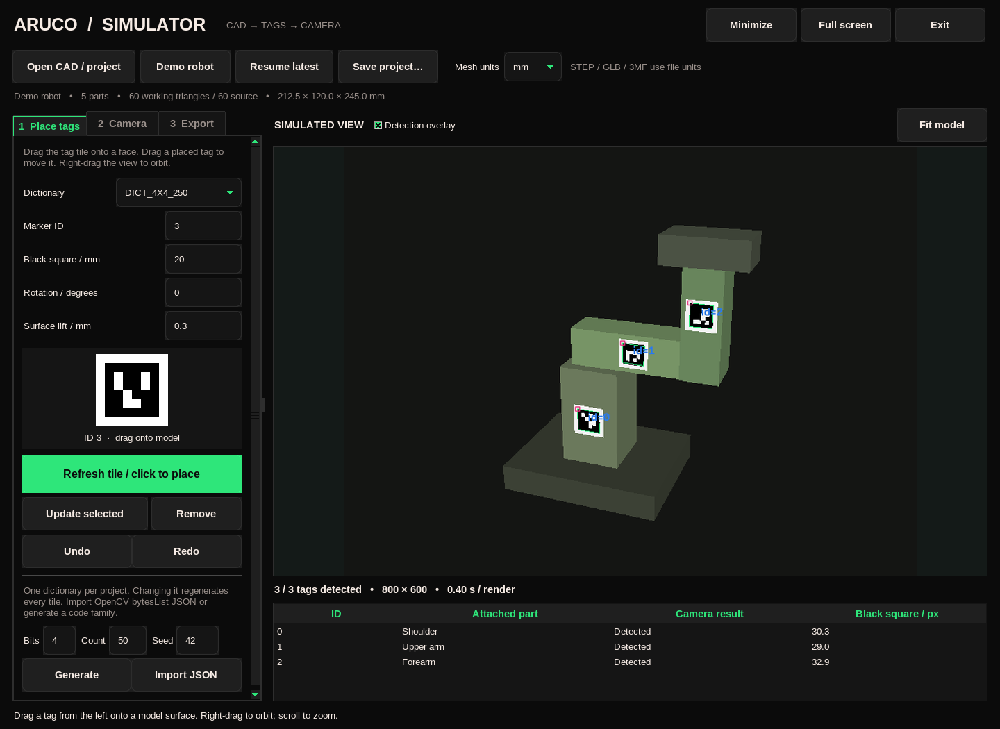

**To use:** `cd aruco_simulator`, then run `python aruco_simulator.py`

# ArUco Simulator

A local desktop laboratory for placing ArUco tags on CAD models and testing
whether a simulated camera can read them. Opens with a small demo robot, ready
to use. No board, physical camera, account, cloud service or sibling project is
needed. Nothing is uploaded.



## The useful part

1. **Open a model.** Drag a file onto the viewport or choose **Open CAD / project**.
   STEP/STP, STL, OBJ, PLY, GLB/GLTF and 3MF are supported. STEP, GLB and 3MF use
   file units; choose mm/cm/m/inch before importing unitless meshes. Check the
   displayed dimensions after import. Native CAD project files need an export.
2. **Make a tag.** Pick an OpenCV dictionary, ID and black-square size in mm.
   Each tile includes a one-cell white quiet zone outside that size. Drag the
   tile onto a solid model face. It snaps to the surface normal. The original
   CAD is never modified; these are virtual mounted tiles, not CAD booleans.
3. **Adjust it.** Select a row to change its size, rotation or lift, then press
   **Update selected**. Drag a placed tile to reposition it. Each ID is unique.
   Undo/Redo covers tag edits, dictionary changes and model replacement.
4. **Test the view.** Right-drag to orbit, scroll to zoom, or use **Camera**.
   Adjust distance, field of view, resolution, blur, noise and exposure.
   **Play camera orbit** sweeps the view around the model.
5. **Move a part.** Select a component in Camera, choose a project-space rotation axis
   and pivot (mm), then rotate it. Its tags follow. Components rotate independently;
   there is no hierarchical joint solver or automatic articulation discovery.
6. **Keep the result.** Export a portable `.aruco` project, raw/annotated camera
   PNGs and detection JSON, printable tag PNGs with a placement/size manifest,
   or a 120-frame, five-second 360° orbit AVI at 24 fps with per-frame results.

The detector runs on the rendered pixels. It does not read the placement table
and pretend a tag was detected. Geometry can occlude tags; blur, reduced size,
angle and noise can make detection fail. The table shows measured black-square
size in pixels only for decoded tags.

## Custom ArUco codes

Built-in families cover 4×4 through 7×7 codes, with 50/100/250/1000 IDs.
Use **Generate** to create a deterministic custom dictionary (4–7 bits,
1–250 IDs, integer seed), or **Import JSON** to load an OpenCV dictionary:

```json
{"markerSize": 4, "maxCorrectionBits": 1, "bytesList": [[[0, 0, 0, 0], [0, 0, 0, 0]]]}
```

That example shows the schema, not a recommended code family. Supply the actual
OpenCV `dictionary.bytesList.tolist()` and matching parameters. Each project
uses one dictionary. Changing it regenerates all tiles. Custom dictionary data
travels inside the saved project and exported marker manifest, so another
machine can reproduce the same codes.

The image includes a quiet zone. Print at the **outer** tile size:
`black_square_mm × (marker_bits + 4) / (marker_bits + 2)`.
For a 4×4 code with a 20 mm black square, the full tile is 26.667 mm.
PNG pixel dimensions alone do not set the physical print size.

## Saving and recovery

Edits autosave to `~/aruco_simulator_maps/<timestamp>/project.aruco`.
Each launch gets a new session; **Resume latest** opens the preceding autosave.
**Save project…** writes a portable copy containing the working mesh arrays,
tag transforms, dictionary, part poses and camera settings. It needs no original
CAD file to reopen. Autosaves use atomic file replacement.

Exports go into timestamped subfolders of that session's `exports/` directory.
Every export keeps its own files. Cancelling a video keeps the partial video
and matching partial detections. Source CAD files are read-only.

Keyboard: **Ctrl+O** open, **Ctrl+S** save a copy, **Ctrl+Z / Ctrl+Y** undo/redo,
**F11** full screen, **Escape** leave full screen / stop orbit / cancel tag
placement, **Ctrl+Q** quit. The sidebar scrolls on shorter screens.

## Installation

Python 3.11+ and Tk are required. The standard-library launcher checks both,
creates `.venv`, asks before installing dependencies, and reuses that environment.
Use `--yes` to accept installation; noninteractive launches accept by default.
Dependencies are installed only into the local `.venv`. The first installation
needs internet; subsequent normal use is offline.

```sh
python aruco_simulator.py doctor
python aruco_simulator.py --help
python aruco_simulator.py gui --project /path/to/model.aruco
python aruco_simulator.py demo --out demo.aruco
```

The app packages its own renderer and theme. It does not import the Digital Twin
Generator, robo_prober or aruco_tag_maker checkouts. Linux is tested here;
Windows/macOS remain pending execution despite platform-independent source.

## What the simulation does and does not establish

| Area | Passed on real hardware (board, date) | Physical test pending |
|---|---|---|
| Desktop GUI | Linux display, 2026-10-27; no board needed | Windows/macOS desktop execution |
| Tag detection | No physical camera test in this app | Compare rendered readability against a real camera |
| Printing | No printer test in this app | Confirm physical tag size, contrast and readability |

This is a pinhole camera with a depth buffer, flat diffuse lighting, Gaussian
blur, additive image noise and exposure scaling. It is not a calibrated OAK-D
sensor model: no lens distortion, rolling shutter, cast shadows, autofocus or
motion-blur model. A successful render is not proof of a successful physical
print/capture. Detection reports explicitly identify simulation.

- CAD materials/textures are replaced by neutral surfaces. Scene transforms
  and separate mesh components are retained; native parametric features are not.
- Large meshes are simplified to about 12,000 working triangles (minimum
  per-component budgets can exceed that for many tiny parts). Originals stay
  untouched; the portable project contains this working copy.
- Tiles are flat. Placement does not prove that all four corners touch a
  curved face or that a mount can be printed. Change size/lift and inspect.
- Independent part rotations are a visual placement test. There is no
  controller/firmware emulator, robot dynamics, automatic joint inference,
  URDF export or camera-pose fitting in this standalone version.
- Interactive orbit advances three degrees per completed render, so its speed
  depends on mesh size/resolution. Exported video uses a fixed 24 fps timeline.

## Development and local checks

```sh
.venv/bin/python -P -m pip install -e '.[test]'
.venv/bin/python -m pytest -q
```

GUI tests require a display and exercise real Tk mouse events for marker dragging,
the native file-drop callback, controls, undo/redo, exports and autosave recovery.
No physical device is opened. See [validation](docs/VALIDATION.md).

Private local source. No remote and no publication workflow.
