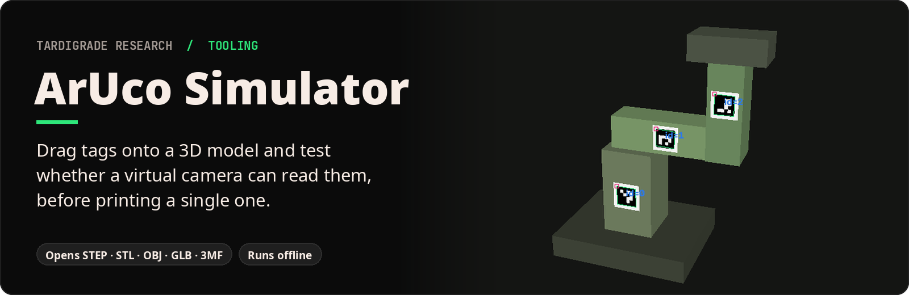
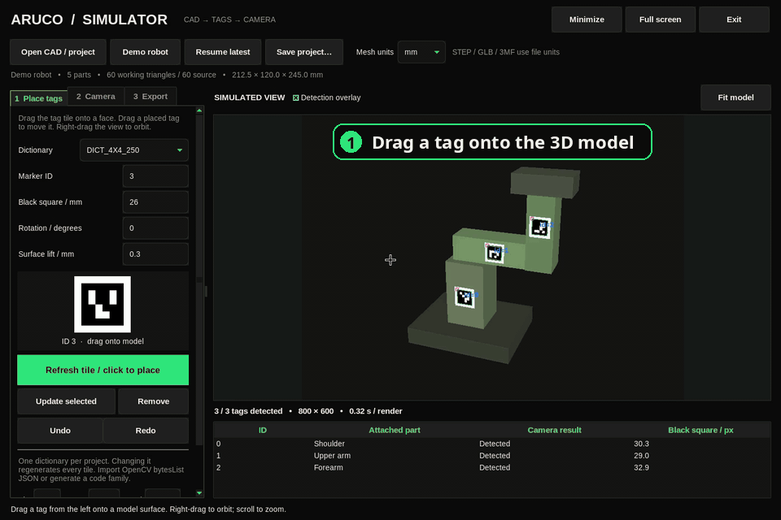
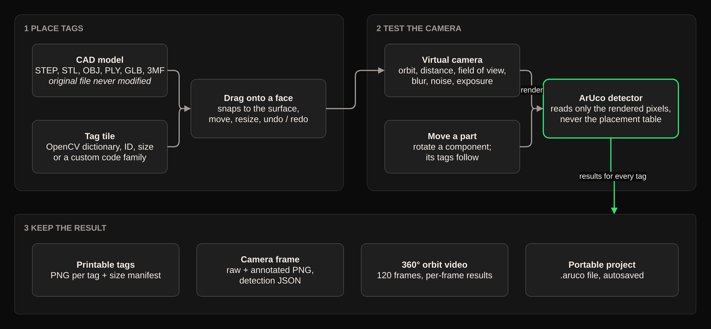

<p align="center"></p>

**What it is.** A desktop app for testing camera markers (ArUco tags, the printed black-and-white squares robots use as landmarks) on a 3D model of your object.

**What it does.** Open a CAD file, drag tags onto its surfaces, then point a virtual camera at it. The app renders what the camera would see and runs the real OpenCV tag detector on those pixels, so you see which tags read and which don't as you change the angle, distance, blur or lighting.

**Why it matters.** Placing tags on a real robot by trial and error means printing, sticking, filming and starting over. Here you find the right size and spot for every tag on screen first, then print only what works.

<p align="center"></p>

*Real screen recording of the app on its built-in demo robot.*

## Quickstart

```sh
git clone https://github.com/tardigraderesearch/aruco_simulator && cd aruco_simulator
python aruco_simulator.py
```

The launcher checks for Python 3.11+ and Tk, asks before creating a private `.venv`
next to itself and installing the libraries into it (nothing system-wide), then opens
the window with a small demo robot ready to use. `--yes` skips the question. The first
run needs internet; after that it works offline, and nothing is uploaded.

## How it works



*Diagram source: [docs/diagrams/architecture.drawio](docs/diagrams/architecture.drawio).*

1. **Open a model.** Drag a file onto the viewport or choose **Open CAD / project**.
   STEP/STP, STL, OBJ, PLY, GLB/GLTF and 3MF are supported. STEP, GLB and 3MF use
   file units; choose mm/cm/m/inch before importing unitless meshes. The source CAD
   file is read-only; tags are virtual tiles mounted on its surface.
2. **Make a tag.** Pick an OpenCV dictionary, ID and black-square size in mm, then
   drag the tile onto a solid face. It snaps to the surface. Each ID is unique.
3. **Adjust it.** Select a row to change its size, rotation or lift, then press
   **Update selected**, or drag a placed tile to a new spot. Undo/Redo covers tag
   edits, dictionary changes and model replacement.
4. **Test the view.** Right-drag to orbit, scroll to zoom, or use the **Camera** tab
   for distance, field of view, resolution, blur, noise and exposure.
   **Play camera orbit** sweeps the view around the model.
5. **Move a part.** Select a component, choose a rotation axis and pivot (mm), and
   rotate it. Its tags move with it.
6. **Keep the result.** Export a portable `.aruco` project, raw and annotated camera
   PNGs with detection JSON, printable tag PNGs with a placement and size manifest,
   or a five-second 360° orbit video (120 frames at 24 fps) with per-frame results.

The detector reads only the rendered pixels, never the placement table, so a tag
counts as found only when the camera image really shows it. Model geometry can hide
tags, and blur, size, angle and noise all affect detection. The results table shows
the measured black-square size in pixels for every decoded tag.

The camera is a pinhole model with a depth buffer, flat diffuse lighting, Gaussian
defocus blur, additive sensor noise and exposure scaling. Large meshes are simplified
to about 12,000 working triangles for speed; the original file stays untouched.

## Custom ArUco codes

Built-in families cover 4×4 through 7×7 codes, with 50/100/250/1000 IDs.
Use **Generate** to create a deterministic custom dictionary (4–7 bits,
1–250 IDs, integer seed), or **Import JSON** to load an OpenCV dictionary:

```json
{"markerSize": 4, "maxCorrectionBits": 1, "bytesList": [[[0, 0, 0, 0], [0, 0, 0, 0]]]}
```

That example shows the schema, not a recommended code family. Supply the actual
OpenCV `dictionary.bytesList.tolist()` and matching parameters. Each project
uses one dictionary; changing it regenerates all tiles. Custom dictionary data
travels inside the saved project and exported marker manifest, so another
machine can reproduce the same codes.

The image includes a quiet zone. Print at the **outer** tile size:
`black_square_mm × (marker_bits + 4) / (marker_bits + 2)`.
For a 4×4 code with a 20 mm black square, the full tile is 26.667 mm.
PNG pixel dimensions alone do not set the physical print size.

## Saving and recovery

Edits autosave to `~/aruco_simulator_maps/<timestamp>/project.aruco`.
Each launch gets a new session; **Resume latest** opens the preceding autosave.
**Save project…** writes a portable copy containing the working mesh arrays,
tag transforms, dictionary, part poses and camera settings. It needs no original
CAD file to reopen. Autosaves use atomic file replacement.

Exports go into timestamped subfolders of that session's `exports/` directory.
Every export keeps its own files. Cancelling a video keeps the partial video
and matching partial detections.

Keyboard: **Ctrl+O** open, **Ctrl+S** save a copy, **Ctrl+Z / Ctrl+Y** undo/redo,
**F11** full screen, **Escape** leave full screen / stop orbit / cancel tag
placement, **Ctrl+Q** quit. The sidebar scrolls on shorter screens.

## Command line

```sh
python aruco_simulator.py doctor
python aruco_simulator.py --help
python aruco_simulator.py gui --project /path/to/model.aruco
python aruco_simulator.py demo --out demo.aruco
```

The app is self-contained: it packages its own renderer and theme and needs none of
the sibling projects ([ArUco Tag Maker](https://github.com/tardigraderesearch/aruco-tag-maker),
[robo_prober](https://github.com/tardigraderesearch/robo_prober),
[Digital Twin Generator](https://github.com/tardigraderesearch/digital-twin-generator)).

## Development

```sh
.venv/bin/python -P -m pip install -e '.[test]'
.venv/bin/python -m pytest -q
```

GUI tests use a display and drive real Tk mouse events for tag dragging, the native
file-drop callback, controls, undo/redo, exports and autosave recovery. See
[validation](docs/VALIDATION.md) and [provenance](docs/PROVENANCE.md).
